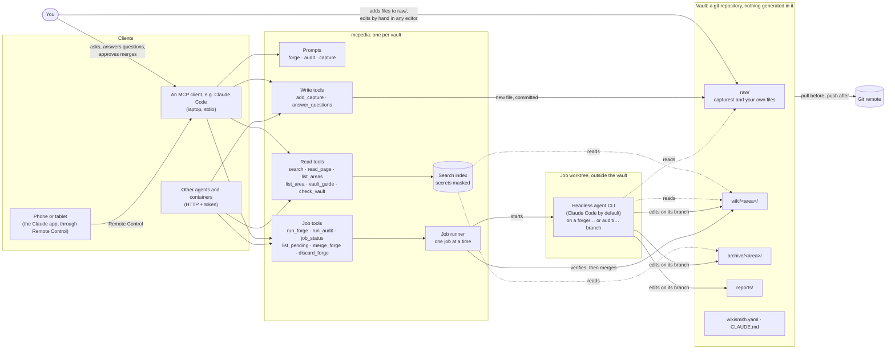
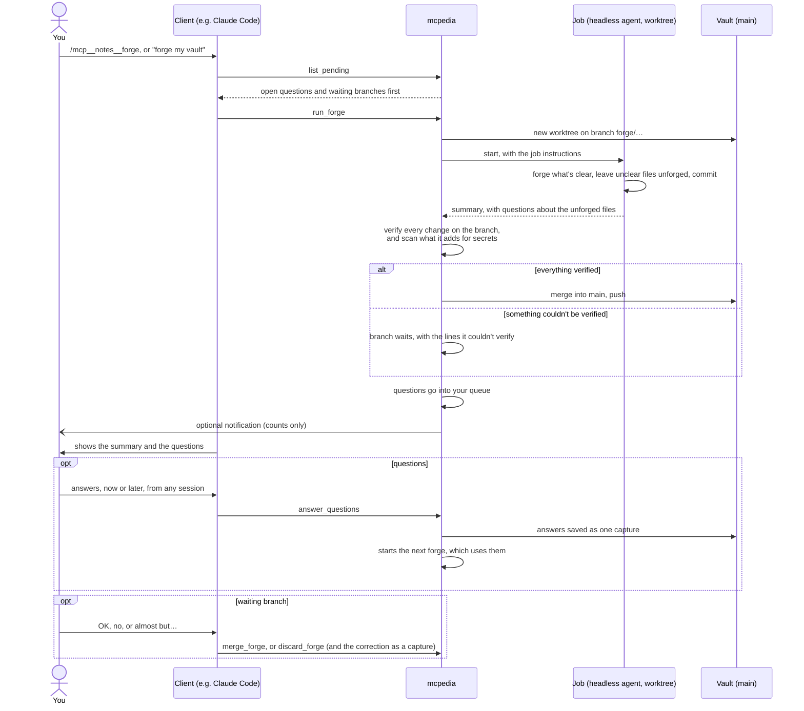
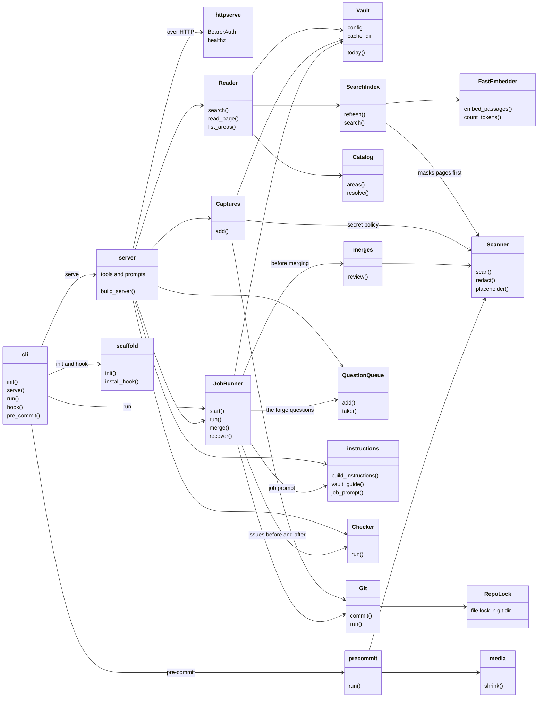

# wikismith

Turn a folder of raw notes into a wiki that your AI agents can use, and keep it current.

You collect material in `raw/`: notes saved from chats, exports, clippings, photos, PDFs. An agent **forges** it into a wiki of plain Markdown pages, one folder per area of your life, every fact cited back to its source. **mcpedia**, wikismith's MCP server, then gives every agent you use a way to search and read that wiki, and to save new notes into it: any MCP client works, on your laptop, in other repos and containers, or on your phone. The vault is a git repository, readable in any editor; [Obsidian](https://obsidian.md) works well but isn't required.

Status: early development, not released. Licensed under MIT.

## How it works



A few rules shape everything else:

- **Only mcpedia writes to the vault.** Agents never edit files; they save captures (a new file in `raw/captures/`), and everything else happens in a forge or audit job on a branch of its own, which mcpedia merges. You can still edit by hand; audits list such edits, for visibility.
- **Agent work is a job, server work is direct.** Forges and audits always run as jobs: an agent in a separate git worktree, on its own branch, with a summary at the end. Captures, reads, checks, merging and discarding are done by mcpedia directly.
- **mcpedia verifies, it doesn't trust.** A job's branch merges by itself only if mcpedia can check every change: new pages and lines, text moved unchanged, pages archived unchanged, link fixes. Rewritten or removed facts wait for you, with only the lines it couldn't verify.
- **The vault is just the vault.** Nothing generated lives in it: the rules, prompts and job instructions come with mcpedia, and the secret hook lives in your git config.
- **Secrets stay out.** They're masked before indexing and in everything agents read; captures follow your secret policy; your own commits pass a secret scan.

### A forge, step by step



## The vault

```
my-vault/
├── raw/              everything you collect, kept as it is: exports, notes, photos, PDFs
│   └── captures/     notes saved through mcpedia, one file each: YYYY-MM-DD_slug.md
├── wiki/
│   ├── _log.md       one line per forged raw file; a raw file not listed here is still new
│   └── <area>/       one folder per area, with an _index.md and its pages
├── archive/<area>/   outdated pages worth looking up; readable, but search skips them unless asked
├── reports/          audit reports
├── wikismith.yaml    settings
└── CLAUDE.md         your own rules for this vault
```

- **Areas** are the folders in `wiki/`. Each has an `_index.md` whose frontmatter has a one-line `description:`; agents see it as the area's summary. A forge never creates an area by itself: it proposes one as a question, and you approve it.
- **Pages** have frontmatter (`title`, `area`, `tags`, `updated`, `sources`), cite every fact as `(source: raw/...)`, and link each other with `[[wikilinks]]`.
- **`raw/` is never edited** after it's committed, by anyone. The layout below `raw/` is up to you.
- **`CLAUDE.md`** holds your own rules (what goes in which area, how careful to be with purchases, …). Agents get it through `vault_guide`, forge jobs in full. It wins over the general rules.

## Setup

Five steps: get wikismith, install it on your machine **or** build the container, create the vault, connect mcpedia, use it. Steps 2a and 2b are alternatives; from step 3 on, the two only differ in how you run a command.

### 1. Get wikismith

wikismith isn't published as a package yet; you install it from its repository:

```
git clone https://github.com/cart1984/wikismith.git
```

### 2a. Install on your machine

You need Python 3.12 or newer, git and [uv](https://docs.astral.sh/uv/).

```
uv tool install ./wikismith            # puts `wikismith` on your PATH
uv tool install './wikismith[heic]'    # the same, plus shrinking iPhone photos (HEIC)
```

**For forge and audit jobs**, install a headless agent CLI: [Claude Code](https://claude.com/claude-code) by default; run `claude` once and log in. Another agent works through `jobs.agent` (see [Another agent](#another-agent)). Searching, reading and capturing work without one.

**Git:** captures, forges and merges are commits, and mcpedia pushes them if the vault has a remote. Two things have to work:

- **Your git identity** (`user.name`, `user.email`): your global one, or one set in the vault. See [Who commits](#who-commits-the-git-identity).
- **Pushing without a prompt**, if the vault has a remote: an SSH key in an agent, or an HTTPS credential helper. Check it with a push from a new terminal: if git asks for nothing, mcpedia can push too. See [Reaching the remote](#reaching-the-remote).

**Running the commands.** Run them from any folder. Each one works on the vault you name with `--vault`; without it, on `$WIKISMITH_VAULT`, else the current folder. `init` takes the folder as its argument instead. These do the same:

```
wikismith check --vault ~/notes           # from anywhere
cd ~/notes && wikismith check             # from inside the vault
export WIKISMITH_VAULT=~/notes            # once, e.g. in your shell profile;
wikismith check                           # then from anywhere, without --vault
wikismith init ~/notes                    # init: the folder is the argument
```

### 2b. Or build and configure the container

For a home server: mcpedia over HTTP, with forge and audit jobs running inside the container. You need Docker with Compose. **There's no published image: you build it**, because the default image includes Claude Code, which isn't ours to redistribute.

The repository's `compose.yaml` is used as it is: your settings go into a `.env` file next to it, which Compose reads.

```
cd wikismith
echo "WIKISMITH_VAULT_DIR=/path/to/your/vault" > .env
echo "WIKISMITH_TOKEN=$(openssl rand -hex 32)" >> .env
echo "WIKISMITH_BIND=<this machine's address on your clients' network>" >> .env
echo "GIT_NAME=Your Name" >> .env
echo "GIT_EMAIL=you@example.com" >> .env
claude setup-token                          # on any machine: a long-lived token for your Claude plan
echo "CLAUDE_CODE_OAUTH_TOKEN=<that token>" >> .env
chmod 600 .env
```

- **`WIKISMITH_VAULT_DIR`** (required): the vault's folder on this machine, mounted as `/vault`. For a new vault, an empty folder.
- **`WIKISMITH_TOKEN`**: every client needs it; anyone with it can read the wiki, capture, start jobs and merge.
- **`WIKISMITH_BIND`** (required): the server's own address on the network your clients use, not the clients' addresses. Clients coming in over a VPN use whichever server address the VPN routes them to. For use on the server only, `127.0.0.1` (an IP; `localhost` may mean `::1`). Binding limits the network, not the devices on it: if anything else on that network can reach the address, restrict it with a firewall.
- **`GIT_NAME` and `GIT_EMAIL`**: who the container's commits are by, since it doesn't see your git config (without them: `mcpedia`).
- **`CLAUDE_CODE_OAUTH_TOKEN`**: for the jobs. Without it, everything else works, and jobs fail with a clear message.
- **Optional:** `TZ` (e.g. `America/New_York`) for the date of captures and forges, and `WIKISMITH_PORT` (default 8765).

`.env` and the `ssh` folder below are gitignored, so they stay out of your clone's commits. For changes to the compose file itself, say another mount or a memory limit, put them in a `compose.override.yaml` (also gitignored), which Compose merges in, instead of editing `compose.yaml`.

**Git access from the container.** If the vault has a remote, put a key for it into an `ssh` folder next to `compose.yaml`; the compose file mounts it read-only. The key must have no passphrase, belong to uid 1000 and have mode 600, and the folder needs a `known_hosts` file with the remote's host key, since nobody can confirm it in the container:

```
mkdir ssh
ssh-keygen -t ed25519 -N "" -f ssh/id_ed25519     # add ssh/id_ed25519.pub to the remote, e.g. as a deploy key with write access
ssh-keyscan <remote host> > ssh/known_hosts
sudo chown -R 1000:1000 ssh && chmod 600 ssh/id_ed25519     # on Docker Desktop: only the chmod
```

The vault's folder has to be writable for uid 1000 too, the user the container runs as. **On Docker Desktop** (macOS, Windows) skip the `chown`, here and for the vault: mounted files show up in the container as its own user's.

Then build the image:

```
docker compose build
```

- **The embedding model is baked into the image**, which then searches without network. For another model, set `search.model` in `wikismith.yaml` and build with the same name: `docker compose build --build-arg WIKISMITH_MODEL=<model>`.
- **Time zone:** set `TZ` in `.env`, or `timezone` in `wikismith.yaml`, so captures and forges use your date.
- `--target server` builds an image without Claude Code: mcpedia only, no jobs. For another agent, add it to the Dockerfile's last stage and set `jobs.agent`.
- The compose file runs the container read-only, without capabilities, as a non-root user.

### 3. Create the vault

On your machine, `wikismith init <folder>`; with the container, the same through Compose, which runs it on the vault's mount:

```
wikismith init ~/notes                              # on your machine
docker compose run --rm mcpedia init /vault --name notes --no-hook   # with the container
```

The vault's name defaults to its folder's; in the container that's always `vault`, hence `--name`. You can change it later in `wikismith.yaml`.

`init` creates the folders, `wikismith.yaml` (every setting, commented, with its default), a starter `CLAUDE.md` and the forge log. It never overwrites anything. It asks two things:

- **Set up git?** Captures, forges and audits need it; without git, mcpedia can only search and read. A new repository gets a first commit; an existing one is left for you to review and commit.
- **Check your own commits?** This enables the pre-commit hook for the vault on this machine: secrets, and large files (see [Your own commits](#your-own-commits)). It changes your global git config, so it asks first. Enable it where you commit by hand, on your own machine; that's why the container command says `--no-hook`. Later: `wikismith hook --vault ~/notes`. The hook runs `wikismith`, so that machine needs it installed (step 2a, without an agent), even if mcpedia runs in the container.

`--git`/`--no-git` and `--hook`/`--no-hook` answer them without asking. What comes next depends on what you start with.

**A new, empty vault.** Put some notes into `raw/`, commit them, and forge (step 5). A new vault has no areas yet, so the first forge proposes a set from what's in `raw/`; answer, and the next forge creates them.

**A folder of notes you already have.** Move your files into a `raw/` folder inside the vault folder, in whatever subfolders they're in now; wikismith never edits them. Run `init` on that folder, and commit; the hook shrinks large images and asks about other large files (see [Large files](#large-files)). The first forge reads everything in `raw/`, proposes areas, and leaves each file it can't place unforged with a question. What to expect:

- **Hundreds of files take a while.** A job is stopped after 30 minutes, and a stopped job keeps nothing: its branch is deleted and all its files stay unforged, so the next forge starts over. For a large first forge, either raise the limit in `wikismith.yaml`:

  ```yaml
  jobs:
    timeout_minutes: 180
  ```

  or forge in batches: keep the files outside the vault, move a few dozen into `raw/`, commit, forge, and repeat. Batches also keep each forge's summary and questions short enough to read.
- **Expect questions**, especially about areas. Answer them in one go; the next forge picks up the answers together with the files.

**A wiki you already built in this layout.** If you already have `raw/`, `wiki/<area>/` and `wiki/_log.md` (say, a vault you've been forging by hand), `init` adds `wikismith.yaml` and leaves the rest alone. Then:

- Give each area's `_index.md` a `description:` line; `wikismith check` lists the ones without.
- Move your areas out of `CLAUDE.md`'s rules if they're listed there: mcpedia reads them from the folders now. Keep the rules about what goes where.
- Remove `@` import lines and instructions for agents to edit the wiki: agents only capture now.

### 4. Connect mcpedia

**On your machine, for clients on the same machine (stdio).** Any MCP client can start mcpedia itself: the command is `wikismith serve --vault ~/notes`. With Claude Code, register it under your vault's name, for all your projects:

```
claude mcp add --scope user notes -- wikismith serve --vault ~/notes
```

Claude Code starts it per session; no token, no network. Its tools appear as `mcp__notes__search` and so on, and its prompts as `/mcp__notes__forge`, `/mcp__notes__audit` and `/mcp__notes__capture`.

**Over HTTP, for other machines and containers.** Start the container:

```
docker compose up -d
```

or, without the container, serve it on your machine:

```
WIKISMITH_TOKEN=$(openssl rand -hex 32) wikismith serve --vault ~/notes --transport http --host <this machine's address>
```

Clients connect to `http://<address>:8765/mcp` with the header `Authorization: Bearer <token>`. With Claude Code:

```
claude mcp add --scope user --transport http notes http://<address>:8765/mcp --header "Authorization: Bearer <token>"
```

The port comes from `--port` or `WIKISMITH_PORT`. A token is required except on loopback, where `--no-auth` is allowed. **This is plain HTTP: the token and everything you read travel unencrypted.** That's fine on a network you trust and inside a VPN. Anywhere else, put a TLS proxy in front (Caddy, for example) or don't expose it.

**Several vaults.** One mcpedia serves one vault, on purpose: each vault has its own secret policy, review rules, git remote and token. Register each under its own name:

```
claude mcp add --scope user notes -- wikismith serve --vault ~/notes
claude mcp add --scope project work -- wikismith serve --vault ~/work-notes   # only in work projects
```

Each server's instructions name its vault, so agents know which one they're talking to. In Docker, use one clone of wikismith per vault, each with its own `.env` (vault folder, port, token); Compose names each clone's cache volume after its folder, so they stay apart.

**Optional, keeping agents out of the files.** Agents are told never to edit vault files, but an agent in a session opened inside the vault folder still could. To rule that out in Claude Code, add a deny rule to `~/.claude/settings.json` (outside the vault); other agents have their own permission settings:

```json
{ "permissions": { "deny": ["Edit(~/notes/wiki/**)", "Edit(~/notes/archive/**)", "Edit(~/notes/raw/**)"] } }
```

### 5. Use it

From here on it doesn't matter where mcpedia runs. In any connected client, just ask:

- **Capture:** "remember that the router's admin page moved to port 8443", or the `capture` prompt. The agent shows what it will save and saves it as a new capture.
- **Search and read:** "what did I decide about the fence?"; the agent searches, reads the pages, and cites their paths.
- **Forge:** "forge my vault", or the `forge` prompt. It shows open questions and waiting branches first, then runs a forge and shows its summary; answer its questions there or later.
- **Audit:** "audit my vault", or the `audit` prompt. The report lands in `reports/`.

**From your phone or tablet.** The easiest way is Claude Code's [Remote Control](https://code.claude.com/docs/en/remote-control): run `claude remote-control` on the machine with mcpedia (in an empty folder of its own, not the vault), and open the session from the Claude app's Code tab. The session runs on that machine, so everything above works from the phone, also away from home, without opening a port; that machine has to stay on. Other ways:

- **Reading:** sync the vault's git repository to the phone, for example into Obsidian; treat it as read-only and capture through mcpedia.
- **An MCP app on the phone** that lets you set the `Authorization` header can connect over HTTP, on your network or through a VPN.
- **Not the Claude app's own connectors:** they're called from Anthropic's servers and sign in with OAuth, so they can't reach mcpedia on a private network with a token.

**Capturing without mcpedia**, from a chat that can't reach it: at the end, ask "Write what we worked out as a note: a title, the date, and the key facts and decisions only, no chat transcript." Save the answer as `raw/captures/YYYY-MM-DD_<short-title>.md` and commit it; the next forge picks it up like any other capture.

From the terminal, a job runs in the foreground; on your machine `wikismith run forge --vault ~/notes`, with the container `docker compose exec mcpedia wikismith run forge`. **Nightly**, with cron on the machine that runs mcpedia:

```
0 3 * * *  wikismith run forge --vault ~/notes                               # on your machine
0 3 * * *  cd ~/wikismith && docker compose exec -T mcpedia wikismith run forge   # with the container
0 4 * * 0  wikismith run audit --vault ~/notes                               # weekly audit
```

## How forges and audits work

A **forge** reads the raw files not yet in `wiki/_log.md`, merges their facts into the right pages, cites every one, and logs each file. An **audit** checks the wiki (links, duplicates, misfiled and outdated pages, contradictions, personal data, large files, direct edits since the last audit, ten facts against their sources) and writes a report to `reports/`; it never changes pages.

Both run as jobs: a headless agent (Claude Code by default) in a git worktree outside the vault, on a branch of its own. Jobs keep running when the session that started them closes, one at a time per vault; a second one queues. Each gets its instructions from mcpedia, plus your `CLAUDE.md` and the vault's settings.

**When a forge merges by itself.** mcpedia checks the branch against `main`, line by line (`src/wikismith/merges.py`), and merges only if every change is verified:

| Merges by itself | Waits for you |
|---|---|
| New pages and lines; frontmatter that only grows | Rewritten or removed lines, listed with examples |
| Index entries extended at the end | Changed frontmatter values |
| Lines moved unchanged (pages merged or split) | Deleted pages whose text appears nowhere else |
| Pages moved to the archive unchanged | New areas you haven't approved |
| Link changes that reduce `wikismith check` issues | Binary files, pages matching `review.flag`, `wikismith.yaml` |
| | New check issues; secrets or personal data in what it adds |

A branch that changes `raw/` is never merged. `review.auto_merge: none` makes every forge wait. Audits only add a report, so they merge by themselves.

**What you see for a waiting branch.** `job_status` and `list_pending` show its summary and, under "Changes that need your OK", the diff of each file that keeps it from merging, with the reason (for example `wiki/garden/my-garden.md (flagged for review)`). The other changed files are listed by name. That's enough to decide in any client, a phone included; a long diff is cut, and the report names the `git diff` command for the rest.

**Questions don't block.** A file the forge can't decide (which area? bought or only considered?) stays unforged, with a question in your queue; the rest of the forge merges. `list_pending` shows open questions first, then waiting branches. Answer with `answer_questions`; your answers become one capture, and a new forge starts that uses them. A waiting branch is only ever merged (`merge_forge`) or discarded (`discard_forge`): for "almost, but…", discard it and capture the correction; the next forge redoes it.

**Corrections wait for you.** When a capture says a fact is wrong or has changed, the forge rewrites the old line instead of adding a correction next to it, so the branch waits for your OK. That's on purpose: a rewrite is exactly the change you'd want to see.

**Large imports.** A forge takes every unforged file at once, and the more it has to read, the more it tends to skim. For an import, add the files to `raw/` in batches with `wikismith import` and let each batch forge before adding the next: a handful of long files (a few hundred lines each) or about 1,500 lines per batch. `wikismith check --check unforged` shows each file's length. A forge that couldn't read a file completely leaves it unlogged and flags it, so the next forge tries again.

**Importing files word for word.** Captures are short notes that pass through an agent. For long material that must go in unchanged (a document, prepared digests, a submitted review), run `wikismith import <files or folders> --to import/<folder>` yourself: it copies them into `raw/import/<folder>/`, runs the same checks as the pre-commit hook (large files, then secrets), and commits them as one commit. It never overwrites a file in `raw/`, and if a check stops it, the copies are removed again. With the vault in Docker, run it on the machine that holds the vault folder, while no forge is running.

**Notifications.** `jobs.notify` runs a command when something waits for you. It gets counts only (`forge: 2 questions, 1 branch waiting`), never content, so a public service like ntfy.sh never sees your notes:

```yaml
jobs:
  notify: [curl, -s, -d, "{message}", "https://ntfy.sh/<your-topic>"]
```

### Another agent

`jobs.agent` is the command mcpedia runs for a job. Any headless agent CLI can do the work if it:

1. reads its instructions from standard input;
2. works in the current folder (the job's worktree): reads and edits files, and runs `git` and `wikismith`;
3. commits on the branch it's on;
4. prints the summary as its last output, and exits with 0.

Only Claude Code has been tried so far. The default runs it with edits allowed and nothing but `git` and `wikismith` as shell commands:

```yaml
jobs:
  agent: [claude, -p, --permission-mode, acceptEdits, --allowedTools, "Bash(git *),Bash(wikismith *),Read,Write,Edit,Glob,Grep"]
```

## Git

Writing needs git: captures are commits, jobs are branches, and git history is how you undo anything. Without a repository, mcpedia is read-only.

| Setup | What happens |
|---|---|
| A remote, `git.sync: true` (default) | Captures, jobs and merges pull first (fast-forward only), so they work on the latest state; commits and merges are pushed after. A failed pull or push is a warning; the commit stays. |
| No remote | Local commits only. |
| `git.sync: false` | Local commits only, even with a remote. |
| `git.commit_captures: false` | Captures are saved but not committed: you commit them. Jobs still commit on their branches. |
| No repository | Read-only: search and reads work; captures and jobs refuse, saying why. |

A capture made while the vault folder is on another branch is saved but not committed, with a note. `git.remote` (default `origin`) and `git.branch` (default `main`) name the remote and the branch mcpedia works with.

### Who commits: the git identity

Captures, forges and merges are commits, so they need a name and an email. mcpedia uses the vault's git identity: the repository's own `user.name` and `user.email` if set, else your global ones. With neither, it commits as `mcpedia <mcpedia@localhost>`. `wikismith init` makes its first commit with the same identity; without one, it says so and leaves the commit to you.

On your machine that's usually your global identity already. To use a different one for the vault:

```
git -C ~/notes config user.name "Your Name"
git -C ~/notes config user.email "you@example.com"
```

The container doesn't see your git config: there, `GIT_NAME` and `GIT_EMAIL` in `.env` set who the commits are by (step 2b).

### Reaching the remote

mcpedia runs plain `git pull` and `git push`, so whatever already works for you in the vault folder works for mcpedia, with one condition: **it must work without a prompt.** mcpedia runs in the background, so there's nobody to type a password or passphrase, or to confirm a new host key. Check with a push from a new terminal: if it goes through without asking anything, mcpedia can push too.

| | On your machine | In the container |
|---|---|---|
| **SSH** (recommended) | Your keys and `~/.ssh/config` as usual. A key with a passphrase works if an agent holds it (ssh-agent, the macOS keychain, 1Password); mcpedia inherits it from the session or shell that starts it. | Mount a folder with a key without a passphrase, and a `known_hosts` file with the remote's host key, as `/home/mcpedia/.ssh` (read-only; `compose.yaml` does this with `./ssh`). The key must belong to uid 1000 and have mode 600, or ssh refuses it. Use a key for the vault only, e.g. a deploy key with write access. |
| **HTTPS** | A credential helper (the macOS keychain, Git Credential Manager, `gh auth setup-git`). | A credential helper that needs no interaction, such as `store` with a credentials file you mount. |
| **A local path** (another folder, a NAS share) | Works as it is. | Mount it into the container too, at the same path the remote URL uses. |

**Don't put a token into the remote's URL** (`https://user:token@…`). It ends up in `.git/config`, where every forge and audit agent can read it with `git remote -v`.

The container also trusts the vault's folder whoever owns it (`safe.directory`), since the mount usually belongs to a different user than the container's. On your machine that's not needed.

## Secrets and personal data

Every capture is scanned for secrets (private keys, API tokens, passwords in URLs and sentences, IBANs, card numbers, US Social Security numbers, plus your own patterns) and personal data (your own patterns, such as a parcel ID). What happens depends on two settings with the same values:

| | `secrets.policy` (secrets) | `secrets.pii` (personal data) |
|---|---|---|
| `allow` | kept | kept; not scanned for |
| `warn` | kept, with a warning | kept, with a warning |
| `redact` (default) | replaced with `***REDACTED-…***` | replaced |
| `block` | the capture is refused | the capture is refused |

- With `secrets.mask_reads` (default), secrets are also masked in everything agents read and before the search index sees them; search snippets show `[secret: GitHub token]`. Under `allow`, a `reveal` tool reads a page unmasked when you ask for a specific value.
- Agents are told the same rules, in a form that holds under every value: under anything but `allow`, no secrets, and other people only by first name or role.
- mcpedia refuses to serve a vault with policy `allow` or `warn` whose remote is a cloud host (GitHub, GitLab, …), unless `secrets.allow_cloud_remote` says that's intended.

Your own patterns go into `wikismith.yaml`; a named group `secret` masks only that part:

```yaml
secrets:
  patterns:
    - id: home-hostname
      regex: '\bmyhome-[a-z0-9]+\.example\.org\b'
      description: Home hostname
    - id: parcel-id                  # a made-up format: use your county's
      regex: '\bPCL-\d{4}-\d{6}\b'
      description: Parcel ID
      pii: true
```

### Your own commits

The same scan runs on your own commits through a pre-commit hook, plus the large-file check below. `wikismith init` offers it; `wikismith hook` adds it later, `wikismith hook --remove` takes it off. It doesn't touch the vault: it adds an `includeIf` for the vault's folder to your global git config, which points `core.hooksPath` at a hook in `~/.config/wikismith/hooks/`. If the vault has its own `.git/hooks/pre-commit`, that still runs. Bypass it once with `git commit --no-verify`.

### Large files

Git keeps every committed version forever, so large files are stopped before they're committed:

- **Images** over 1,600 px or 500 KB are shrunk (photos to JPEG, screenshots stay PNG), with their metadata removed (GPS location included); BMP, TIFF and HEIC are always converted. The original is kept in the vault's cache folder for 30 days. With `files.images: ask`, you decide per image.
- **Other files** over 1 MB (scanned PDFs, manuals, videos) are always asked about: keep, leave out, or abort.
- Without a terminal to ask (Obsidian Git, GUI clients), asking means refusing, with a hint. `wikismith shrink <images>` shrinks by hand.
- Files already in the vault over these limits (committed before the hook, or without it) are listed by `wikismith check --check large`, and by audits. What to do with them is up to you: the history keeps them either way.

The limits are settings in `wikismith.yaml`, shown here with their defaults:

```yaml
files:
  image_max_px: 1600   # images are shrunk to this long edge ...
  image_max_kb: 500    # ... and this size
  images: shrink       # shrink, or ask (per image, in a terminal)
  max_kb: 1024         # other files over this are asked about
```

The checks apply to every file you commit to the vault, not only to `raw/`: Obsidian, for example, puts pasted images into the vault's root folder.

Agents read images at about 1,600 px anyway; forges cite images and PDFs like any other source and embed images from `raw/` (`![[photo.jpg]]`) instead of copying them.

## Search and embedding models

`search` blends keyword matching (BM25) with local embeddings, which match by meaning, and returns the best section of each page. The model runs locally with [fastembed](https://github.com/qdrant/fastembed); nothing leaves the machine. Pages are split at headings into chunks of at most 400 tokens, fewer if the model reads less.

| Use | Model (`search.model`) | Size | Reads |
|---|---|---|---|
| Default: English, small and good | `BAAI/bge-small-en-v1.5` | 67 MB | 512 tokens |
| Very little memory | `minishlab/potion-retrieval-32M` | 130 MB, very fast | 512 tokens |
| Better English | `BAAI/bge-base-en-v1.5` | 210 MB | 512 tokens |
| Long pages | `nomic-ai/nomic-embed-text-v1.5-Q` | 130 MB | 8,192 tokens |
| Several languages, small | `sentence-transformers/paraphrase-multilingual-MiniLM-L12-v2` | 220 MB | 128 tokens (small chunks) |
| Several languages, better | `google/embeddinggemma-300m` | 1.2 GB | 2,048 tokens |

Each model gets the query and passage prefixes it expects. Changing the model re-embeds the vault once. `search.semantic: false` turns embeddings off (keywords only); `wikismith fetch-model --model <name>` downloads a model ahead of time.

## Running in Docker: what else to know

- **Health:** `/healthz` (no token) reports whether the vault is readable and the search index built, and answers 503 when not, which makes the container unhealthy. It never shows paths or content.
- **The cache volume** holds each vault's embeddings and jobs; the model lives in the image (`/models`), so a rebuild with another model takes effect even with an old volume.
- **Updating:** pull the new wikismith, then `docker compose build && docker compose up -d`.

## Reference

### Commands

| Command | What it does |
|---|---|
| `wikismith init [path]` | Create a vault, or add what's missing. `--name`, `--git`/`--no-git`, `--hook`/`--no-hook` |
| `wikismith serve` | Run mcpedia. `--transport stdio` (default) or `http`, `--host`, `--port`, `--no-auth` (loopback only) |
| `wikismith run forge\|audit` | Run a job in the foreground, e.g. from cron |
| `wikismith check` | The mechanical checks: `links`, `orphans`, `frontmatter`, `index`, `names` (a page name used twice), `unforged`, `secrets`, `large`. `--check similar` (only when asked for) lists pairs of pages that share much of their text, possible duplicates. `--check <name>`, `--limit`; exit 1 on issues |
| `wikismith import <files> --to <folder>` | Copy files or folders into `raw/<folder>` word for word, check them like the hook does, and commit them |
| `wikismith search <query>` | Search from the terminal. `--top-k`, `--area` |
| `wikismith hook` | Enable the pre-commit hook for this vault; `--remove` disables it |
| `wikismith pre-commit` | What the hook runs: large files, then the secret scan |
| `wikismith scan [files]` | Scan files for secrets; `--staged` scans what's staged |
| `wikismith shrink <images>` | Shrink images to the vault's limits; originals kept for 30 days |
| `wikismith fetch-model` | Download an embedding model ahead of time. `--model` |

Every command that works on a vault takes `--vault <folder>`; the default is `$WIKISMITH_VAULT`, else the current folder.

### MCP tools and prompts

| Tool | |
|---|---|
| `search` | Search by meaning and keywords; `area`, `top_k`, `include_archive` |
| `read_page` | A page by name, area path or vault path |
| `list_areas`, `list_area` | The areas with their descriptions; an area's index and pages |
| `vault_guide` | How to use this vault, with your full `CLAUDE.md`; `include_conventions` adds the general rules |
| `check_vault` | The mechanical checks |
| `add_capture` | Save a note into `raw/captures/`; `forge_now` starts a forge |
| `answer_questions` | Save your answers to forge questions, approve proposed areas, and forge again |
| `run_forge`, `run_audit` | Start a job; returns at once |
| `job_status` | A job's state and summary; `wait_seconds` (up to 120) waits for it |
| `list_pending` | Open questions and branches waiting for review |
| `merge_forge`, `discard_forge` | Settle a waiting branch (clients ask you first) |
| `reveal` | Only under policy `allow`: read a page without masking |

Prompts: `forge`, `audit` and `capture`. Claude Code shows them as `/mcp__<name>__forge` and so on; other clients list them in their own way, or the agent uses the tools directly when asked.

### Settings

`wikismith init` writes `wikismith.yaml` with every setting, commented, at its default; uncomment what you change. mcpedia never changes it. The sections: `name`, `description`, `timezone`, `layout` (folder names), `files` (large files), `access` (what agents may read), `secrets`, `git`, `search`, `review` (`auto_merge`, `flag`), `jobs` (`agent`, `timeout_minutes`, `notify`). Unknown keys and wrong types are errors, so a typo never goes unnoticed.

## Development

Set up a development environment in the repository folder:

```
uv sync
```

Run the tests:

```
uv run pytest
```

They need no network and no AI: semantic search is tested with a small stand-in for the embedding model, and forge and audit jobs with a script that stands in for the agent and makes fixed changes.

One test runs the real embedding model, to check that it finds pages by meaning and that no chunk is too long for it. It's skipped unless you ask for it, because the model has to be downloaded first (67 MB, once):

```
wikismith fetch-model                   # download the default model
WIKISMITH_TEST_MODEL=1 uv run pytest    # all tests, including the one with the real model
```

Before committing, check the code style (ruff) and the types (pyright); CI runs the same:

```
uv run ruff check && uv run ruff format --check && uv run pyright
```

How the code fits together:



- **`server.py`** only wires things up: each tool is a few lines calling a plain class, and the classes are tested without MCP.
- **`src/wikismith/assets/`** holds what agents read: the server instructions, the general rules, the job instructions and the prompts. They matter as much as the code.
- Tests use real git repositories with a local bare remote, real MCP clients (in process, over stdio and over HTTP) and a fake agent that stands in for the job agent.
